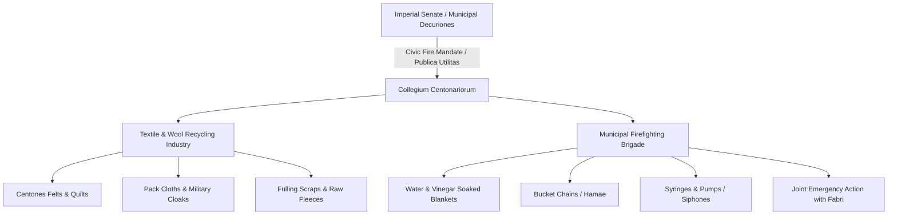

# Centonarii

The *centonarii* were artisans and merchants specializing in the production and distribution of *centones*—heavy, coarse wool felts, blankets, and patchwork textiles manufactured from scraps of salvaged cloth, fulling offcuts, and dense wool. Operating across Rome, Italian municipia, and the western provinces, the *collegium centonariorum* formed one of the three recognized municipal corporations (*tria collegia principalia*), standing alongside the *fabri* (builders) and *dendrophori* (timber-haulers)[^garcia-tria-cent]. Because saturated wool blankets were the most effective technology for smothering urban fires, Roman municipal authorities formally integrated the *centonarii* into civic emergency defenses as municipal firefighting brigades.

## Textile Manufacture and Commercial Operations

In everyday commercial life, *centonarii* played an indispensable economic role within the urban textile economy:

* **Production of Centones:** The Latin term *cento* designated both patched coverlets stitched from remnant squares of cloth and dense, felted wool mats treated to resist wear. These fabrics were utilized as utilitarian saddle blankets, wagon covers, packing wraps for overseas merchant cargo, bedding for urban slave quarters, and thermal insulation in insula tenements.
* **Military Ballistic and Siege Fabrics:** In Roman military operations, *centones* were soaked in vinegar or water and draped over wooden siege towers (*turres*), battering rams (*arietes*), and ship bulwarks to protect wooden assault machinery from enemy incendiary darts and flaming pitch (Caesar, *Bellum Civile* 2.9, 3.44)[^caesar-centones].
* **Commercial Integration:** *Centonarii* maintained close commercial links with fullers (*fullones*), wool dyers (*infectores*), and cloth shearers (*tonsores*), purchasing offcuts, discarded garments, and raw wool waste to reprocess into sturdy, low-cost manufactured goods.

## Municipal Fire Brigades

While the city of Rome had seven cohorts of specialized imperial night-watchmen (*vigiles*) established by Augustus in 6 CE, Italian municipia and provincial colonies lacked permanent public firefighting services. Roman administrative law systematically co-opted the *centonarii* to fill this vacuum:

1. **Smothering Urban Fires:** At the outbreak of a fire, *centonarii* mobilized their inventories of dense wool *centones*. When thoroughly drenched in water or vinegar, these mats sealed off oxygen, containing fires within timber-frame domestic apartments.
2. **Equipment and Tools:** Inscriptions and archaeological records show that *centonarii* maintained specialized equipment stockpiles in their guildhalls (*scholae*), including bronze firefighting force-pumps (*siphones*), leather water buckets (*hamae*), long hooks for pulling down burning awnings (*perticae*), ladders, and axes.
3. **Coordinated Emergency Operations:** During major municipal conflagrations, the *centonarii* operated in tandem with the *fabri* (who demolished adjacent structures to establish firebreaks) and the *dendrophori* (who cleared heavy burning timbers).

## Social Status, Governance, and Legal Privileges

The social composition of the *collegium centonariorum* drew heavily from affluent freedmen (*liberti*) and freeborn plebeians:

* **Internal Organization:** Like municipal senates, the collegium was governed by annually elected *magistri* or *quinquennales*, supervised by *decuriones* and assisted by treasurers (*curatores pecuniae communis*).
* **Civic Recognition and Immunities:** Because their firefighting service fulfilled an indispensable public utility (*publica utilitas*), the emperors granted *centonarii* exemptions (*immunitates*) from compulsory municipal labor and personal civic liturgies (*munera personalia*) (Dig. 50.6.6)[^dig-centonarii].
* **Imperial Scrutiny:** When Pliny the Younger served as governor of Bithynia-Pontus (c. 110 CE), he wrote to Emperor Trajan requesting permission to establish a 150-man guild of *fabri* or *centonarii* to combat devastating fires in Nicomedia. Trajan famously refused the request, citing the risk that even well-intentioned trade associations in provincial Greek cities inevitably degenerated into seditious political clubs (*hetaeriae*) (Pliny, *Epistulae* 10.33–34)[^pliny-trajan]. This highlights the strict imperial oversight governing authorized guilds.

## Late Imperial Evolution

By the fourth century CE, the Diocletianic reforms and the Theodosian Code transformed the voluntary municipal guilds into hereditary, compulsory state corporations (*corpora obligata*). Under *Codex Theodosianus* 14.8, sons of *centonarii* were legally bound to remain in the trade, ensuring that Roman municipal defense and textile procurement for the army remained continuously manned during the crises of late antiquity.

## Sources

[^garcia-tria-cent]: Antonio López García, *Running Rome and Its Empire: The Spaces of Administration in the Roman World* (London: Routledge, 2024), `_raw/Antonio Lopez Garcia_2024_Running Rome and Its Empire.epub`, chunks 621–665, analyzing the civic roles, *publica utilitas*, and epigraphic distribution of the *centonarii*.
[^caesar-centones]: Julius Caesar, *Bellum Civile* 2.9 (draping of *centones* over siege engines at Massilia) and 3.44 (protection against missile fire).
[^dig-centonarii]: Digest 50.6.6.12 (Callistratus), confirming imperial exemptions from municipal liturgies granted to craftsmen providing emergency civic protection.
[^pliny-trajan]: Pliny the Younger, *Epistulae* 10.33–34 (correspondence between Pliny and Trajan concerning the proposed guild in Nicomedia and the political dangers of *collegia*).
