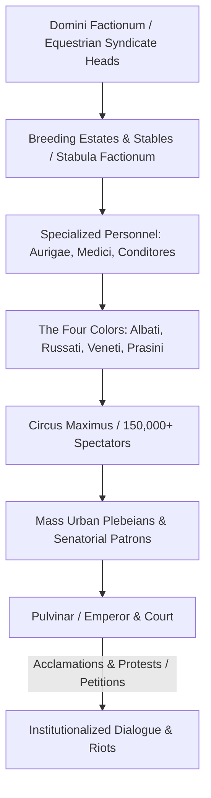

# Circus Factions

The *factiones circenses* were the professional corporate enterprises and fanatical sporting factions that managed, provisioned, and contested chariot races in the Circus Maximus and across the provincial hippodromes of the Roman and Byzantine worlds[^ancient-rome-circus]. Operating as private capital syndicates owned by equestrian managers (*domini factionum*), the factions supplied magistrates and emperors with trained racing teams (*aurigae*), four-horse chariots (*quadrigae*), bloodstock horses, and track personnel. Over time, the four primary factions—distinguished by their colors: the **Whites** (*Albati*), **Reds** (*Russati*), **Blues** (*Veneti*), and **Greens** (*Prasini*)—evolved from commercial supply contractors into mass socio-political movements capable of channeling popular dissent, imperial acclamations, and violent urban riots.

## Corporate Infrastructure and the Domini Factionum

During the Republic and early Principate, organizing circus games (*ludi circenses*) was the legal duty of elected magistrates (praetors, aediles, and consuls). Because breeding thoroughbred racing horses and training chariot drivers required immense long-term capital, individual magistrates could not maintain private stables. Instead, they contracted out racing operations to commercial corporate syndicates:

* **The Domini Factionum:** The syndicates were founded, financed, and directed by equestrian business contractors styled *domini factionum*. These equestrian magnates owned sprawling stud farms across Cappadocia, Thessaly, Baetica, and North Africa, breeding bloodstock horses noted for speed and stamina.
* **The Four Colors:** The four traditional factions were:
  * **The Whites (*Albati*):** Symbolizing winter, the elements of air and snow; traditionally associated with the older aristocratic order.
  * **The Reds (*Russati*):** Symbolizing summer and fire; traditionally allied as a junior partner with the Whites.
  * **The Blues (*Veneti*):** Symbolizing autumn, the sea and water, or the sky; backed heavily by senatorial aristocrats and traditional elites.
  * **The Greens (*Prasini*):** Symbolizing spring and the green earth; historically drawing fervent devotion from the urban plebs, soldiers, and populist emperors.
* **Specialized Guild Workforce:** Within their walled metropolitan compounds in the Campus Martius (*stabula factionum*), each faction maintained a vast division of labor:
  * *Aurigae* or *Agitatores* (chariot drivers), ranging from skilled slaves who could purchase their freedom to star drivers celebrated in epigraphs (such as Gaius Appuleius Diocles, who accumulated over 35 million sesterces in prize purses)[^diocles-purse].
  * *Conditores* (stable managers) and *veterinarii* (equine doctors).
  * *Moratores* (grooms who held the horses at the starting gates, or *carceres*).
  * *Sparsores* (track attendants who dashed cold water over chariot wheel axles to prevent friction fires).
  * *Iubilatores* (outriders who galloped alongside charioteers to shout tactical guidance).

## Imperial Partisanship and Elite Rivalry

During the Principate, Roman emperors frequently abandoned imperial detachment to display passionate partisan devotion to specific colors:

* **Caligula (Gaius):** Caligula was fanatically devoted to the Greens (*Prasini*). He regularly dined and slept in the Green faction's stables in the Campus Martius, showered his favorite charioteer Eutychus with gifts totaling millions of sesterces, and lavished his prize racing horse Incitatus with a marble stall, an ivory manger, purple blankets, and a household of slaves (Suetonius, *Caligula* 55)[^suet-caligula].
* **Nero:** Passionate about chariot driving, Nero favored the Greens, sporting their color in public, driving his own chariots in the Circus, and appointing factional leaders to high court administrative posts (Suetonius, *Nero* 22).
* **Lucius Verus and Commodus:** Lucius Verus carried a golden figurine of the Green horse Volucer with him, while Commodus raced in public under the Green colors.
* **Absorption of the Smaller Colors:** In the late first century CE, Emperor Domitian attempted to introduce two new factions—the **Golds** (*Aurati*) and the **Purples** (*Purpurei*)—but they were abandoned following his assassination. By the second and third centuries, the Whites had been formally subordinated into the Blues, and the Reds into the Greens, establishing a bipolar sporting and political rivalry between Blues and Greens across the Roman Mediterranean.

## The Circus as a Political Arena: Acclamations and Riots

Following the end of free popular elections under Tiberius in 14 CE, the **Circus Maximus**—with an expanded seating capacity exceeding 150,000 to 250,000 citizens—became the primary venue for direct communication between the Roman ruler and the mass urban populace[^cameron-circus].

* **The Architecture of Interaction:** The emperor sat in the **Pulvinar**, an elevated imperial box constructed on the northern slope of the Palatine Hill, providing a direct visual line across the racing track to the gathered citizens.
* **Synchronized Acclamations:** The plebs organized themselves by factional seating sectors. Under the direction of designated claque-leaders (*choregountes*), tens of thousands of spectators chanted rhythmically in unison. These acclamations served as semi-constitutional political negotiations[^roueche-acclamations]. The crowd demanded lower grain prices, the dismissal of hated imperial ministers (such as Cleander under Commodus in 190 CE), tax remissions, or the execution of corrupt officials.
* **Urban Warfare:** Factional devotion routinely spilled out of the arena into violent street battles. Backed by private weapons and organized gangs of youths (*iuvenes*), Blues and Greens fought pitched battles in city streets, ambushed rival partisans in taverns, and attacked imperial magistrates who attempted to discipline factional rowdies. This politicization reached its historical zenith in the eastern empire with the **Nika Riots** of 532 CE in Constantinople, where the unified Blues and Greens burned down half the imperial capital and nearly toppled Emperor Justinian I.

## Sources

[^ancient-rome-circus]: Penelope J. E. Davies et al., *Ancient Rome: An Urban History* (Cambridge: Cambridge University Press), `_raw/Ancient Romeepub.pdf`, pp. 488–492, analyzing the architectural development, seating capacity, and social functions of the Circus Maximus.
[^diocles-purse]: *CIL* XIV, 2884 (the career monument of the Lusitanian charioteer Gaius Appuleius Diocles), recording 4,257 races, 1,462 victories, and earnings of 35,863,120 sesterces across the Red and Green factions.
[^suet-caligula]: Suetonius, *Divus Caligula* 55.2–3; see also Josephus, *Antiquitates Iudaicae* 19.254–258, cited in `_raw/Rome's Enemies Withinepub.pdf`, p. 313, documenting imperial devotion to the Green faction.
[^cameron-circus]: Alan Cameron, *Circus Factions: Blues and Greens at Rome and Byzantium* (Oxford: Oxford University Press, 1976), cited in `_raw/9789004401631-13611.pdf`, p. 339 (printed p. 323), detailing the semi-constitutional status of crowd acclamations and the organizational transition from equestrian entrepreneurs to state-managed imperial factions.
[^roueche-acclamations]: Charlotte Roueché, "Acclamations in the Later Roman Empire: New Evidence from Aphrodisias," *Journal of Roman Studies* 74 (1984): 181–199, examining rhythmic acclamation transcripts, claque organization, and civic petitioning in Roman arenas.
