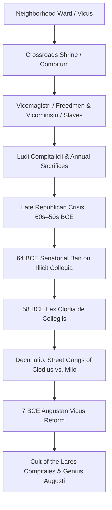

# Collegia Compitalicia

The *collegia compitalicia* (also termed *collegia vicorum* or street-clubs) were neighborhood ward associations centered upon crossroads shrines (*compita*) throughout the city of Rome. Originally organized around the annual winter festival of the **Compitalia** and the worship of the *Lares Compitales* (crossroads guardian spirits), these neighborhood networks integrated freeborn plebeians, freedmen, and urban slaves under the leadership of local ward-masters (*vicomagistri*)[^mouritsen-vici]. During the late Roman Republic, they were transformed into paramilitary political syndicates that dominated urban street politics, prompting senatorial bans, Clodian militarization (*decuriatio*), and ultimate imperial restructuring under Augustus.

## Structure of the Republican Vicus and Compitum

Archaic tradition attributed the institutionalization of the *vici* (urban wards) and *compita* (crossroads intersections) to King Servius Tullius. In urban topography, a *compitum* was the meeting point of multiple streets, where an open-air stone shrine was erected honoring the guardian spirits of the neighborhood:

* **Vicomagistri and Vicoministri:** Each ward elected four *vicomagistri* (almost exclusively drawn from prosperous freedmen) and four *vicoministri* (recruited from municipal and private slaves). This provided lower-class residents and non-citizens with recognized institutional prestige and local administrative jurisdiction.
* **The Compitalia Festival:** Celebrated annually in late December or early January following the Saturnalia, the festival featured sacrifices of honey-cakes, the hanging of woolen dolls and balls (*effigies* and *pilae*) representing every free and enslaved member of the household to propitiate the underworld, and multi-day theatrical and athletic spectacles known as the **Ludi Compitalicii**[^ancient-rome-compitalia].
* **Social and Commercial Cohesion:** Because Roman neighborhoods frequently concentrated specific trades (such as shoemakers in the *Argiletum* or metalworkers in the *Vicus Tuscus*), the *collegia compitalicia* closely overlapped with local artisan fraternities and tavern circles.

## Republican Militarization and Clodian Gangs (64–52 BCE)

In the political polarization following the Sullan civil wars, ambitious politicians recognized the *vici* as an organized popular voting base:

* **The 64 BCE Senatorial Ban:** Observing that ward clubs were operating as organized voting syndicates and agitational platforms during the consular elections, the Senate passed a decree (*senatus consultum*) in 64 BCE abolishing all *collegia* deemed harmful to the state (*contra rem publicam*) and prohibiting the celebration of the *Ludi Compitalicii*[^mouritsen-ban].
* **The Lex Clodia de Collegiis (58 BCE):** Upon assuming the plebeian tribunate in December 59 / January 58 BCE, Publius Clodius Pulcher struck directly at senatorial power by enacting the *Lex Clodia de collegiis*. The law restored all suppressed associations and legalized the unrestricted formation of new neighborhood and craft guilds.
* **Decuriatio (Paramilitary Mobilization):** Clodius mobilized the ward networks into a disciplined, military-style urban apparatus. Using personal assistants (*operarum duces*) and local *vicomagistri*, Clodius enrolled ward members into squads (*decuriae*), distributed arms, and stationed detachments across key bottlenecks of the city:
  * In 58 BCE, Clodius' ward squads blockaded the home of Marcus Tullius Cicero, driving him into exile and burning his Palatine mansion.
  * Clodian gangs besieged the consul Gnaeus Pompeius Magnus inside his domus for months, effectively paralyzing the executive government.
  * In 57–52 BCE, conservative aristocrats retaliated in kind: Titus Annius Milo and Publius Sestius raised private counter-gangs composed of gladiators (*familiae gladiatoriae*) and rural clients, sparking continuous street clashes in the Forum and along the Via Sacra[^mommsen-clodius].
* **The Curia Conflagration (52 BCE):** When Clodius was slain by Milo's henchmen in a skirmish at Bovillae along the Via Appia in January 52 BCE, the grief-stricken plebs and ward members carried his corpse into the Senate House (*Curia Hostilia*), constructed a pyre of magistrates' benches and archival scrolls, and burned down the historic senate building.

## The Augustan Reorganization (7 BCE)

To permanently dismantle factional street warfare while harnessing neighborhood civic identity, Augustus enacted a comprehensive municipal overhaul:

1. **The Fourteen Regions and 265 Vici:** In 7 BCE, Augustus divided Rome into 14 administrative regions (*regiones*), each subdivided into individual *vici* (numbering approximately 265 across the capital)[^ancient-rome-augustan].
2. **Reorientation of Cult:** The private political functions of the *collegia compitalicia* were eradicated under the *Lex Iulia de collegiis*. Augustus placed the crossroads shrines under direct imperial patronage. The traditional *Lares Compitales* were re-dedicated as the **Lares Augusti**, flanked by the **Genius Augusti** (the guardian spirit of the emperor).
3. **Institutionalized Municipal Status:** The *vicomagistri* retained their offices and status, wearing the magistrate's toga (*toga praetexta*) and attended by two lictors on festival days. However, their duties were stripped of political autonomy and converted into municipal public services: monitoring neighborhood fire hazards, managing local fountain water distribution, and maintaining neighborhood registries under the supervision of the *Praefectus Urbi*.

## Sources

[^mouritsen-vici]: Henrik Mouritsen, *Plebs and Politics in the Late Roman Republic* (Cambridge: Cambridge University Press, 2001), `_raw/Plebs and Politics in the Late Roman Republicpdf.pdf`, pp. 91–93 (printed pp. 83–85), examining the topographical structure of the *vici*, popular mobilization, and the compital cult.
[^ancient-rome-compitalia]: Penelope J. E. Davies et al., *Ancient Rome: An Urban History* (Cambridge: Cambridge University Press), `_raw/Ancient Romeepub.pdf`, pp. 248–252, documenting the rituals of the Compitalia and the architectural layout of compital shrines.
[^mouritsen-ban]: Mouritsen, *Plebs and Politics in the Late Roman Republic*, `_raw/Plebs and Politics in the Late Roman Republicpdf.pdf`, pp. 150–152 (printed pp. 142–144), discussing the 64 BCE senatorial ban and Clodius' immediate reenactment of the festival and passage of the *Lex Clodia*.
[^mommsen-clodius]: Theodor Mommsen, *The History of Rome*, Book V, `_raw/_extracted/Mommsen - The History of Rome (bks. 1-5).txt`, chunk 4813, detailing the military arrangement of Clodius' street-clubs and the resulting anarchy.
[^ancient-rome-augustan]: Davies et al., *Ancient Rome: An Urban History*, `_raw/Ancient Romeepub.pdf`, pp. 280–285, analyzing Augustus' 7 BCE reform of the 14 Regions, the 265 vici, and the incorporation of the *Genius Augusti*.
