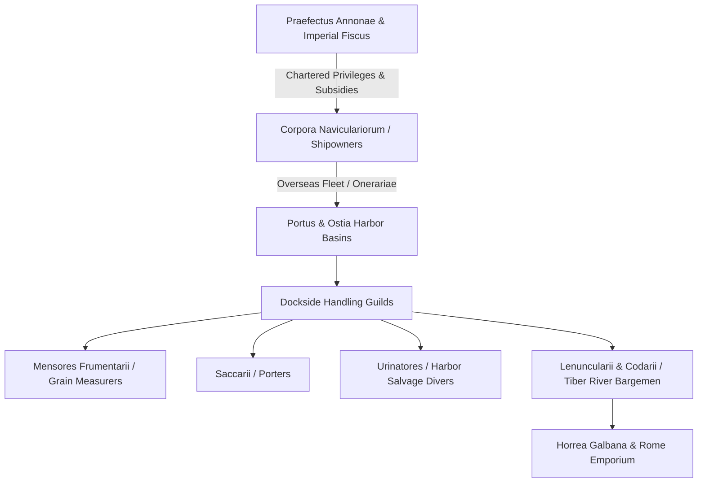

# Corpora Naviculariorum

The *corpora naviculariorum* were chartered maritime shipowners' guilds and maritime transport corporations under contract with the Roman state to haul grain, olive oil, wine, and building timber to the capital under the authority of the *Praefectus Annonae* (Imperial Grain Prefect)[^garcia-scholae]. While private merchants and shipowners operated throughout the Republic, the explosive growth of Rome's metropolitan population during the early Principate—requiring an estimated 200,000 to 400,000 tonnes of grain annually from Egypt, Africa Proconsularis, Sicily, and Baetica—compelled the imperial state to integrate maritime shippers directly into public service (*navicularii publici*).



## State Subsidies and Legal Privileges

To incentivize wealthy provincials and Italian shipowners to dedicate vessels of at least 10,000 modii (c. 70 metric tons) to the state grain supply, successive emperors granted extensive fiscal and legal exemptions:

* **Claudius' Risk Guarantee:** Following severe winter grain riots in Rome, Claudius guaranteed shipowners against storm damage and shipwreck at state expense, granting Roman citizenship to Latin freedmen who built seaworthy cargo ships (*naves onerariae*) and dedicated them to the grain trade for six years (Suetonius, *Claudius* 18–19)[^claudius-annona].
* **Exemption from Municipal Liturgies (*Munera*):** Under Hadrian and the Antonine emperors, members of recognized *corpora naviculariorum* received legal immunity (*vacatio*) from burdensome civic offices, municipal jury duty, and local taxation, provided their vessels actively served the imperial *annona* (Dig. 50.6.6)[^dig-munera].
* **Legal Incorporation:** Recognized navicularii were organized into formal legal corporations (*corpora legitima*), governed by elected magistrates (*praefecti*, *quinquennales*, and *curatores*) and patronized by senatorial or equestrian *patroni*.

## The Piazzale delle Corporazioni at Ostia

The operational and symbolic headquarters of overseas commerce at the mouth of the Tiber was the **Piazzale delle Corporazioni** (Square of the Corporations) at Ostia, situated directly behind the municipal theater[^ancient-rome-piazzale].

```
┌─────────────────────────────────────────────────────────────────┐
│                    THEATER OF OSTIA                             │
├─────────────────────────────────────────────────────────────────┤
│                     PORTICO / WALKWAY                           │
│  [Statio 1]  [Statio 2]  [Statio 3]  ...  [Statio 61]          │
│  Narbo       Alexandria  Carthage         Sabratha              │
│                                                                 │
│                OPEN COLONNADED FORUM                            │
│                 (TEMPLE OF ANNONA)                              │
│                                                                 │
└─────────────────────────────────────────────────────────────────┘
```

The complex contained 61 distinct offices (*stationes*) arranged along a colonnaded quadriporticus surrounding a central temple dedicated to the imperial cult or Annona:
* **Representational Mosaics:** The threshold of each statio featured black-and-white floor mosaics displaying the guild's identity, shipping routes, and commercial insignias. Motifs included two-masted cargo vessels, lighthouses (the Pharos of Alexandria and Portus lighthouse), grain modii, dolphins, and unloading cranes.
* **Provincial Hubs:** Prominent stationes represented shippers from across the Mediterranean:
  * *Navicularii Karthaginienses* (Carthage)
  * *Navicularii Misuenses* (Sidi Daoud, Tunisia)
  * *Navicularii Gummitani* (Gummi, Africa)
  * *Navicularii Sabrathenses* (Sabratha, Tripolitania)
  * *Navicularii Narbonenses* (Narbo Martius, Gallia Narbonensis)
  * *Navicularii Arelatenses* (Arles, Gaul)
  * *Navicularii Alexandrini* (Alexandria, Egypt)
* **Functional Character:** While historically interpreted as trade guild union halls, architectural analysis demonstrates that stationes functioned primarily as commercial showrooms, scheduling bureaus, and logistical points of contact where provincial agents negotiated grain delivery receipts, inspection certificates, and return freights with imperial procurement procurators[^garcia-stationes].

## Dockside Guilds and Transshipment Logistics

Upon reaching the maritime harbor of Portus (constructed by Claudius and expanded into a hexagonal basin by Trajan), grain was handed over to a hierarchy of specialized waterfront guilds:

* **Mensores Frumentarii (Grain Measurers):** Publicly certified measurers who verified the volume and quality of imported grain using standardized modius containers, operating from the *Aula dei Mensores* at Ostia. They sealed cargo registers to prevent fraudulent adulteration by shippers.
* **Saccarii (Porters):** Specialized laborers who hoisted grain bags from deep holds, loaded dockside carts, and transferred cargo into the vast imperial granaries (*horrea*).
* **Lenuncularii and Codarii (Boatmen and Bargemen):** Because deep-draft sea vessels (*naves onerariae*) could not navigate the shallow, winding Tiber upriver to Rome, cargo was shifted into flat-bottomed river barges (*codicariae*). The *corpus codicariorum* towed barges upstream using teams of oxen or men along the towpaths (*alzaia*) to the Emporium district beneath the Aventine Hill.
* **Urinatores (Divers):** Professional salvage divers organized into an imperial guild, contracted to recover sunken anchors, lost cargo, and sunken ship timbers within the harbor basins.

## Sources

[^garcia-scholae]: Antonio López García, *Running Rome and Its Empire: The Spaces of Administration in the Roman World* (London: Routledge, 2024), `_raw/Antonio Lopez Garcia_2024_Running Rome and Its Empire.epub`, chunks 621–670, detailing the administrative roles, *publica utilitas*, and scholae of Ostian shipping associations.
[^claudius-annona]: Suetonius, *Divus Claudius* 18.2–19.1; see also Tacitus, *Annales* 12.43 on the vulnerability of Rome's urban food supply to maritime interruption.
[^dig-munera]: Digest 50.6.6.3 (Callistratus) on the fiscal immunities of *navicularii* performing public transport duties for the grain reserve (*annona urbis*).
[^ancient-rome-piazzale]: Penelope J. E. Davies et al., *Ancient Rome: An Urban History* (Cambridge: Cambridge University Press), `_raw/Ancient Romeepub.pdf`, pp. 309–310, examining the architectural plan, mosaics, and operations of the 61 stationes at Ostia's Piazzale delle Corporazioni.
[^garcia-stationes]: Taco Terpstra, *Trading Communities in the Roman World* (Leiden: Brill, 2013), cited in López García, `_raw/Antonio Lopez Garcia_2024_Running Rome and Its Empire.epub`, chunk 670, clarifying the role of stationes as provincial commercial showrooms rather than permanent administrative scholae.
