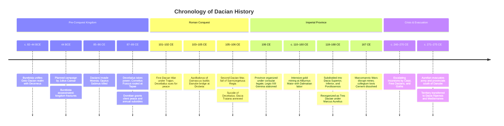

# Dacia

Dacia was an ancient region and kingdom in southeastern Europe centered on the Carpathian basin and Transylvanian plateau, bounded by the Danube (*Danuvius* or *Ister*) to the south, the Tisza to the west, and the Dniester (*Tyras*) to the east. After decades of frontier friction and inconclusive conflict under Domitian, the kingdom was conquered by Trajan in two campaigns (101–102 and 105–106 CE) and annexed as the imperial province of *Dacia Traiana*. It was the only major Roman territorial acquisition north of the lower Danube, heavily garrisoned and intensively exploited for its rich gold and silver deposits, before mounting military pressure prompted Emperor Aurelian to evacuate the salient c. 271–275 CE.

## Chronology

## Geography, ethnography, and early kingdom

Before its annexation, Dacia occupied a prominent place in the Roman strategic imagination as a remote, icy, and martial frontier land beyond the Danube, often compared to the mythic Scythian wilderness across the boundary of the civilized Mediterranean world.[^geography] The population—termed *Daci* in Latin sources and *Getae* in Greek authors—belonged to the wider Thracian linguistic group and established fortified hilltop settlements (*davae*) guarded by murus Dacicus stone ramparts.

A unified Dacian power first emerged in the mid-first century BCE under King Burebista, who consolidated the Geto-Dacian tribes, extended his hegemony toward the Black Sea Greek colonies, and allied with Pompey against Julius Caesar. Caesar was preparing an expedition against Dacia at the time of his assassination in 44 BCE, an enterprise cut short by his death and the near-simultaneous assassination and internal fracturing of Burebista's realm.[^caesar]

During the late first century CE, King Decebalus reconstituted a unified Dacian state centered on the heavily fortified religious and political capital of Sarmizegetusa Regia in the Orăștie Mountains.[^decebalus-state] Archaeological finds at Sarmizegetusa Regia, such as ceramic storage vessels stamped *Decebalus per Scorilo*, attest to royal production administration and early adoption of Latin epigraphic models.[^stamps]

## Flavian conflicts and Trajanic conquest

Dacian raids across the frozen Danube into Moesia in 85–86 CE provoked Domitian's Dacian Wars (85–89 CE), in which the praetorian prefect Cornelius Fuscus was killed and his legions routed at Tapae. Although Rome restored the military balance under Tettius Julianus in 88 CE, Domitian negotiated a compromise peace in 89 CE that granted Decebalus client-king status, technical personnel, and annual subsidies. In Roman aristocratic opinion, this financial concession was viewed as a humiliating tributary payment that compromised imperial prestige.[^domitian-subsidies]

Trajan resumed offensive operations upon his accession to eliminate the Danubian threat. The First Dacian War (101–102 CE) forced Decebalus to accept harsh terms, surrender artillery and Roman deserters, and dismantle border forts. When Decebalus rearmed and raided neighboring Roman allies, Trajan launched the Second Dacian War (105–106 CE), orchestrating one of the largest troop concentrations in imperial history.[^troop-scale]

The conquest was anchored by unprecedented engineering works along the Danube frontier. Trajan cut a rock-shelf military road through the cliffs of the Iron Gates and commissioned the architect Apollodorus of Damascus to erect a monumental stone bridge across the Danube at Drobeta (modern Drobeta-Turnu Severin). Spanning over a kilometer with twenty massive stone masonry piers, the bridge established permanent logistical communications between Moesia and the Carpathian interior while visually asserting Roman mastery over the river frontier.[^bridge]

Roman legions advanced through the mountain passes and besieged Sarmizegetusa Regia, destroying its sanctuaries, royal quarters, and cistern networks. Decebalus fled into the eastern mountains and committed suicide with a curved falx sword to evade capture. The emperor’s cavalry scout, Tiberius Claudius Maximus, intercepted the dying king and delivered his severed head and right hand to Trajan at the camp of Ranisstorum; the relics were dispatched to Rome and exhibited on the Gemonian Steps.[^claudius-maximus] The campaigns, the suicide of Decebalus, and the deportation of Dacian captives were commemorated on the spiraling frieze of [[entities/trajans-column|Trajan’s Column]] in Rome and the *Tropaeum Traiani* at Adamclisi in Moesia Inferior.[^monuments]

## Provincial administration and the mining economy

Trajan organized the conquered heartland as an imperial province governed by a consular *legatus Augusti pro praetore*, establishing a new administrative and colonial capital at *Colonia Ulpia Traiana Augusta Dacica Sarmizegetusa*, located forty kilometers west of the native mountain capital. To manage the exposed salient between the Sarmatians (Iazyges and Roxolani) and the Carpi, the administration was subdivided under Hadrian into *Dacia Superior* and *Dacia Inferior* (with *Dacia Porolissensis* created along the northern Carpathian limes), and consolidated under Marcus Aurelius into the *Tres Daciae* under a single consular legate.[^provinces]

The strategic and economic justification for retaining Dacia lay in its extraordinary mineral wealth, particularly the gold and silver mines of the Apuseni Mountains (*Metalliferi*). The central mining hub at *Alburnus Maior* (modern Roșia Montană) was organized under imperial procurators (*procurator aurariarum*). To operate the subterranean galleries, the imperial government directed large-scale population transfers, importing specialist mining communities from Dalmatia, including the Pirustae and Baridustae.[^mining-migration]

Extensive epigraphic records preserved on wooden wax tablets (*tabulae ceratae*) recovered from the ancient galleries of *Alburnus Maior* illustrate the legal and social fabric of the mining district. These tablets record labor contracts (*locatio conductio operarum*), loans, transactions, and the statutes of voluntary associations (*collegia*). An inscription from May 167 CE records the formal dissolution of a burial society (*collegium Iovis Cerneni*), whose membership had dwindled from fifty-four to seventeen as a consequence of labor flight and disruptions during the Marcomannic Wars.[^collegia]

Because the native population had been severely depleted, displaced, or enslaved during the conquest, the province was colonized by organized migration from across the Mediterranean world (*ex toto orbe Romano*). Colonists, veterans, traders, and administrators settled in newly founded urban foundations including Apulum, Napoca, Potaissa, and Drobeta.[^woolf-migration] However, urban civilization in Dacia remained closely tied to the requirements of the military apparatus and mineral extraction; unlike in Gaul or Hispania, municipal self-government and extensive villa landscapes did not develop deep local agrarian roots outside the garrisons and mining valleys.[^kulikowski-infrastructure]

## Military defense and strategic withdrawal

Dacia formed an exposed salient north of the Danube, requiring a massive permanent garrison that placed heavy demands on imperial military manpower. *Legio XIII Gemina* was permanently stationed at Apulum (Alba Iulia), supplemented from the 160s CE by *Legio V Macedonica* transferred to Potaissa (Turda), alongside dozens of auxiliary cavalry and infantry units distributed across more than a hundred forts (*castra*) and earthen ramparts (*limes Dacicus*).

During the third-century crisis, holding the Carpathian salient became increasingly unsustainable. As the Carpi, Free Dacians, and migrating Gothic confederations launched continuous assaults against the Danube frontier, the empire could no longer afford the garrisons needed to defend Dacia while simultaneously securing Moesia, Thrace, and Illyricum.[^kulikowski-withdrawal]

Between 271 and 275 CE, Emperor Aurelian resolved to evacuate trans-Danubian Dacia (*Dacia Transdanuvina*). The legions, administrative staff, and civilian provincial population were systematically withdrawn south of the river into Moesia. To mitigate the political embarrassment of surrendering a province conquered by Trajan, Aurelian reorganized territory south of the Danube into a new administrative region named *Dacia Aureliana*, later divided by Diocletian into *Dacia Ripensis* (along the Danube bank) and *Dacia Mediterranea* (interior Moesia and Dardania). Following the Roman withdrawal, the northern territory passed into the hands of the Carpi, Goths, and Gepids, terminating 165 years of direct Roman rule north of the Danube.[^aurelian-sources]

## Sources

[^geography]: Susan P. Mattern, *Rome and the Enemy: Imperial Strategy in the Principate* (Berkeley: University of California Press, 1999), `_raw/_archived/Susan P. Mattern_1999_Rome and the Enemy.epub`, chunk.679, analyzing Pliny's portrayal of Dacia as an icy, mythic frontier beyond the barrier of the Danube.

[^caesar]: *Warfare and Society in Imperial Rome, C. 31 BC–AD 280*, `_raw/_archived/Warfare and Society in Imperial Rome, C. 31 BC-AD 280epub.pdf`, p. 23, noting Julius Caesar's planned expedition against the Dacians prior to his death in 44 BCE.

[^decebalus-state]: Christer Bruun, “The Legend of Decebalus,” in *Roman Rule and Civic Life: Local and Regional Perspectives* (Impact of Empire, vol. 4), ed. L. de Ligt, E. A. Hemelrijk, and H. W. Singor (Amsterdam: J. C. Gieben, 2004), [[_raw/_archived/9789004401655-13612.pdf#page=171|PDF p.171, printed p.153]], reviewing Decebalus' stature among Rome's adversaries.

[^stamps]: Bruun, [[_raw/_archived/9789004401655-13612.pdf#page=178|PDF p.178, printed p.160]], citing the stamped pottery from Sarmizegetusa Regia (*Decebalus per Scorilo*) and evaluating proposed royal filiation versus potter workshop marks.

[^domitian-subsidies]: Mattern, *Rome and the Enemy*, chunks 121 and 853; Bruun, [[_raw/_archived/9789004401655-13612.pdf#page=176|PDF p.176, printed p.158]], discussing the Flavian campaigns and contemporary literary silences.

[^troop-scale]: Bruun, [[_raw/_archived/9789004401655-13612.pdf#page=191|PDF p.191, printed p.173]], noting Trajan's concentration of Roman forces as one of the largest mobilizations in imperial history.

[^bridge]: Mattern, *Rome and the Enemy*, chunks 481–483, discussing Trajan’s rock-cut road at Orșova and Apollodorus of Damascus's stone bridge at Drobeta, its twenty stone piers, and its dual logistical and psychological functions.

[^claudius-maximus]: Bruun, [[_raw/_archived/9789004401655-13612.pdf#page=179|PDF pp.179–182, printed pp.161–164]], examining the Grammeni stele of Ti. Claudius Maximus (AE 1969/70, 583), the death of Decebalus, and the exhibition of his head on the Gemonian Steps; Mattern, *Rome and the Enemy*, chunks 483 and 498, on the capture of Decebalus' royal treasure in 106 CE.

[^monuments]: Bruun, [[_raw/_archived/9789004401655-13612.pdf#page=182|PDF pp.182–183, printed pp.164–165]]; see also [[entities/trajans-column]] for the sculpted war narrative and the victory tropaeum at Adamclisi (CIL 3, 1444 = ILS 1022).

[^provinces]: Michael Kulikowski, *The Triumph of Empire: The Roman World from Hadrian to Constantine* (Cambridge, MA: Harvard University Press, 2016), `_raw/_archived/Michael Kulikowski_2016_The Triumph of Empire.epub`, chunks 461 and 556; see also [[concepts/provinces-of-the-roman-empire]].

[^mining-migration]: Mattern, *Rome and the Enemy*, chunk.496, on the importation of Dalmatian mining labor; chunk.555, on the intensity of Roman exploitation of the Dacian gold mines.

[^collegia]: Jinyu Liu, “Group Membership, Trust Networks, and Social Capital: A Critical Analysis,” in *Work, Labour, and Professions in the Roman World*, ed. Koenraad Verboven and Christian Laes (Leiden: Brill, 2016), [[_raw/_archived/9789004331686-33951.pdf#page=198|PDF pp.198 and 224, printed pp.182 and 208]], analyzing the wax tablet dissolution document of the *collegium Iovis Cerneni* at *Alburnus Maior* (CIL III p. 924 = IDR I 31).

[^woolf-migration]: Greg Woolf, “Moving Peoples in the Early Roman Empire,” in *The Impact of Mobility and Migration in the Roman Empire*, ed. Elio Lo Cascio and Laurens E. Tacoma (Leiden: Brill, 2017), [[_raw/_archived/978900334809-34002.pdf#page=64|PDF p.64, printed p.52]], discussing state-sponsored colonization *ex toto orbe Romano* (Eutropius 8.6.2).

[^kulikowski-infrastructure]: Kulikowski, *The Triumph of Empire*, chunk.461, on the failure of deep civilian municipal infrastructure to take root beyond the direct logistical orbit of the military and the mines.

[^kulikowski-withdrawal]: Kulikowski, *The Triumph of Empire*, chunk.556, evaluating the strategic unprofitability and defensibility of the Carpathian basin amidst third-century Gothic and Carpic incursions.

[^aurelian-sources]: Woolf, “Moving Peoples,” [[_raw/_archived/978900334809-34002.pdf#page=64|PDF p.64, printed p.52]], analyzing Eutropius 9.15.1 and the *Historia Augusta* (*Aurelian* 39.7) regarding the evacuation of soldiers and provincials (*sublato exercitu et provincialibus*) to create *Dacia Ripensis* and *Dacia Mediterranea* south of the Danube; Kulikowski, chunk.556.
