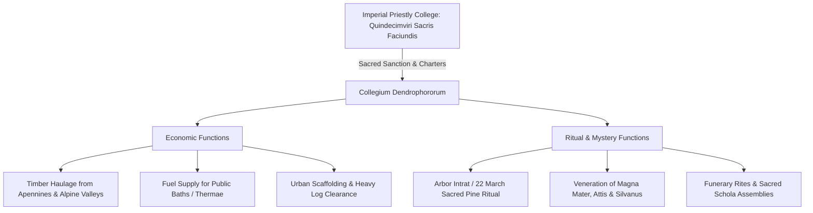

# Dendrophori

The *dendrophori* (Greek: δενδροφόροι, "tree-bearers") were commercial timber-haulers, lumbermen, and wood merchants who occupied a dual position in Roman society: economically, they transported and traded heavy lumber for civic construction, shipbuilding, and bath-heating; religiously, they served as the sacred sodality that cut, carried, and processed the sacred pine tree during the annual March mysteries of Magna Mater (Cybele) and Attis[^verboven-dendro]. Alongside the *fabri* and *centonarii*, they constituted the third recognized municipal corporation of the *tria collegia principalia* across the western Roman Empire.

## Economic Role and Heavy Timber Logistics

Rome's urban metabolism demanded immense volumes of structural timber, naval lumber, and firewood. The *dendrophori* managed the extraction and transportation networks linking Italian forests to metropolitan consumer markets:

* **Haulage from the Interior:** Timber harvested in the Apennines and central Italian river valleys was hauled overland by heavy draft oxen to river embarkation points. Logs were bundled into timber rafts (*rates*) and floated down the Tiber, Anio, or Nar rivers to Rome's lumber docks near the Aventine and the Portus commercial complex.
* **Fuel for Public Baths (*Thermae*):** Rome's monumental imperial baths (the Baths of Titus, Trajan, Caracalla, and Diocletian) and hundreds of private neighborhood bathhouses consumed thousands of cords of firewood daily to fire their subterranean hypocaust furnaces. The *dendrophori* maintained continuous commercial contracts to deliver dense oak and beech fuel stocks.
* **Civic Emergency Operations:** During urban fires and structural collapses, *dendrophori* deployed their specialized teams, draft beasts, and tackle to haul smoldering beams and heavy structural debris out of blocked roadways, allowing the *fabri* and *centonarii* to operate unhindered.

## Sacred Duties in the Cult of Cybele and Attis

Unlike strictly professional trade guilds, the *dendrophori* operated under the direct religious supervision of the state priestly college of the **Quindecimviri Sacris Faciundis** (the Fifteen Men for Sacred Rites), who oversaw the state-sanctioned worship of foreign deities[^verboven-quindecim].

Under the imperial religious reforms instituted by Emperor Claudius in the mid-first century CE (documented by John Lydus, *De Mensibus* 4.59), the Phrygian rites of Cybele and Attis were reorganized into an official annual liturgical calendar held between March 15 and March 27:

1. **The Arbor Intrat (22 March):** The central ritual duty of the *dendrophori* was the felling and ritual conveyance of the sacred pine tree (*arbor intrat*), representing the mythic tree under which Attis died. The guild felled a pine tree in the woods, wrapped its trunk in woolen bandages like a corpse, adorned it with violet garlands, and tied an effigy of Attis to its branches.
2. **The Sacred Procession:** Carrying the massive pine aloft on their shoulders, the *dendrophori* processed through the streets of Rome to the Temple of Magna Mater on the Palatine Hill, accompanied by the crashing bronze cymbals, tambourines, and flutes of the Galli (eunuch priests of Cybele).
3. **Veneration of Silvanus:** Alongside Cybele and Attis, the *dendrophori* maintained an ardent devotion to **Silvanus Dendrophorus**, the Roman god of woodlands, dedicating stone altars, sacred groves, and guild sanctuaries in his honor throughout Italy and the Danubian provinces.

## Internal Organization and Elite Patronage

The internal structure of the *collegium dendrophororum* combined professional trade leadership with cultic priesthoods:

* **Officers:** Guild governance was exercised by *quinquennales*, *magistri*, *decuriones*, and *sacerdotes* (priests drawn from within the brotherhood).
* **Guildhalls (*Scholae*):** Dendrophori established decorated meeting halls in major commercial centers. Epigraphic records from Ostia and Lugdunum (Lyon) document spacious scholae decorated with statues of Cybele, Attis, and the ruling emperors, hosting corporate feasts funded by membership dues and bequests.
* **Elite Patrons:** Because their dual role as municipal logistics contractors and state-supervised priests lent them substantial prestige, prominent municipal aristocrats, equestrian officers, and imperial officials frequently served as *patroni dendrophororum*.

## Late Imperial Repression

Because the religious identity of the *dendrophori* was deeply embedded in the mystery cult of Magna Mater, their fortunes diverged sharply from the other two *tria collegia* during the Christianization of the empire. While the *fabri* and *centonarii* retained their legal recognition as indispensable civil engineering and firefighting bodies, the *dendrophori* were classified as pagan cult organizations. In 415 CE, Emperor Honorius and Emperor Theodosius II issued a formal decree (*Codex Theodosianus* 16.10.20) dissolving the *collegia dendrophororum* and confiscating their communal lands and halls to the imperial treasury[^theodosian-dendro].

## Sources

[^verboven-dendro]: Koenraad Verboven and Christian Laes, eds., *Work, Labour, and Professions in the Roman World* (Leiden: Brill, 2016), `_raw/9789004331686-33951.pdf`, pp. 193–194 (printed pp. 177–178), analyzing the religious origins, trade functions, and legal oversight of the *dendrophori*.
[^verboven-quindecim]: Ibid., p. 193, citing the supervision of the *dendrophori* by the *Quindecimviri Sacris Faciundis* and their suppression under Theodosius II.
[^theodosian-dendro]: *Codex Theodosianus* 16.10.20 (415 CE); see also Antonio López García, *Running Rome and Its Empire: The Spaces of Administration in the Roman World* (London: Routledge, 2024), `_raw/Antonio Lopez Garcia_2024_Running Rome and Its Empire.epub`, chunk 665, note 27, discussing epigraphic attestations and Claudian origins (Lydus, *De Mensibus* 4.59).
