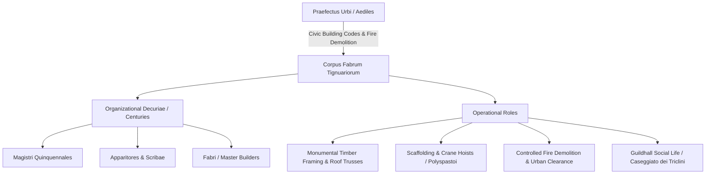

# Fabri Tignuarii

The *collegium* or *corpus fabrum tignuariorum* was the corporate association of master builders, carpenters, roof framers, and construction contractors in ancient Rome, Ostia, and Italian municipalities. As the premier component of the recognized *tria collegia principalia* (the three municipal guilds of *fabri*, *centonarii*, and *dendrophori*), the *fabri tignuarii* exercised a virtual monopoly over private insula development, monumental civic building projects, scaffolding engineering, and post-fire urban reconstruction[^verboven-labour].

## Organizational Hierarchy and Scale

The internal governance of the *fabri tignuarii* mirrored military and civic institutions, demonstrating high corporate sophistication:

* **Century and Decuria Structure:** In Rome, the *fabri tignuarii* were organized into sixty centuries (*centuriae*), while the Ostian branch was divided into three distinct centuries subdivided into decuriae. The Ostian *album* (membership register) from 198 CE preserved in epigraphic records lists approximately 350 active master builders, indicating an extensive network of affiliated journeymen, apprentices, and slave laborers under their direction[^epigraph-album].
* **Magistrates and Officers:** The corporation was led by elected *magistri quinquennales* serving five-year terms, assisted by *curatores* (treasurers), *praefecti*, *scribae* (notaries/archivists), and *viatores* (messengers).
* **Patronage Network:** Because public contracts and legal charters required high-level political backing, the *fabri tignuarii* co-opted wealthy equestrian municipal patrons, imperial freedmen, and senatorial magistrates as *patroni collegii*, dedicating statues, marble tablets, and civic banquets in their honor.

## Civic Infrastructure and Engineering Expertise

Roman monumental construction relied heavily on temporary and permanent timber engineering executed exclusively by *fabri tignuarii*:

1. **Centering and Vaulting (*Armatura*):** The pouring of Roman concrete (*opus caementicium*) for barrel vaults, cross vaults, and massive cupolas (such as the Pantheon) required intricate wooden centering frameworks (*arma* or *formae*) engineered to withstand enormous lateral loads until the hydraulic mortar cured.
2. **Scaffolding and Lifting Engines:** Master builders designed complex multi-story timber scaffoldings and operated mechanical cranes (*trispastos*, *pentaspastos*, and *polyspastos*) equipped with treadwheels, pulley blocks, and guy ropes to hoist multi-ton marble column shafts, architraves, and travertine blocks.
3. **Timber Roof Trusses:** They fabricated immense clear-span wooden trusses spanning major public basilicas (such as the Basilica Ulpia) and bath halls, sourcing straight, aged spruce and fir from northern Apennine forests.
4. **Emergency Demolition and Fire Defense:** Alongside the *vigiles* and the *centonarii*, the *fabri tignuarii* operated axes, saws, and battering rams during city fires. By rapidly leveling surrounding insulae and pulling down burning roofs, they created firebreaks to contain catastrophic conflagrations.

## The Guildhall: Caseggiato dei Triclini at Ostia

The social and ritual life of the Ostian builders was centered in the **Caseggiato dei Triclini** (Regio I, Insula XII), a lavish two-story guild complex constructed during the reign of Hadrian (c. 120 CE)[^lopez-garcia-scholae]:

* **Architectural Layout:** The complex featured a grand peristyle courtyard surrounded by dining halls (*triclinia*) equipped with permanent masonry couches where members reclined for corporate banquets (*epulae*).
* **Assembly and Archives:** The schola contained an *aedicula* for the imperial cult, administrative offices for the *magistri*, an archive room holding bronze and marble *alba*, and a private latrine.
* **Cult and Commensality:** Members met regularly to celebrate imperial birthdays, the festival of Minerva (patron deity of craftsmen celebrated during the *Quinquatrus* in March), and funerals for deceased brethren funded by collective burial treasuries (*arcae*).

## Legal Standing and the Principate

Under the *Lex Iulia de collegiis* promulgated by Augustus, unauthorized artisan associations were dissolved to eliminate political front organizations. The *fabri tignuarii*, however, received explicit senatorial and imperial recognition as a *collegium legitimum* on grounds of *publica utilitas* (public utility)[^dig-fabri]. In exchange for continuous availability during civil emergencies and monumental state infrastructure drives, the state granted the guild exemptions from select municipal taxes, corporate ownership of property, and the right to accept testamentary bequests.

## Sources

[^verboven-labour]: Koenraad Verboven and Christian Laes, eds., *Work, Labour, and Professions in the Roman World* (Leiden: Brill, 2016), `_raw/9789004331686-33951.pdf`, pp. 180–195 (printed pp. 164–179), detailing the professional composition, civic prestige, and structural roles of the *fabri*.
[^epigraph-album]: *Corpus Inscriptionum Latinarum* (CIL) XIV, 4569 (the 198 CE album of the Ostian *fabri tignuarii*); see also CIL VI, 9405 for the Roman corpus.
[^lopez-garcia-scholae]: Antonio López García, *Running Rome and Its Empire: The Spaces of Administration in the Roman World* (London: Routledge, 2024), `_raw/Antonio Lopez Garcia_2024_Running Rome and Its Empire.epub`, chunks 621–635, analyzing the architectural layout, banqueting facilities, and administrative functions of the Caseggiato dei Triclini at Ostia.
[^dig-fabri]: Digest 47.22.1–4 and 50.6.6.12, documenting the legal status of authorized trade corpora providing necessary civic labor (*opera publica*).
