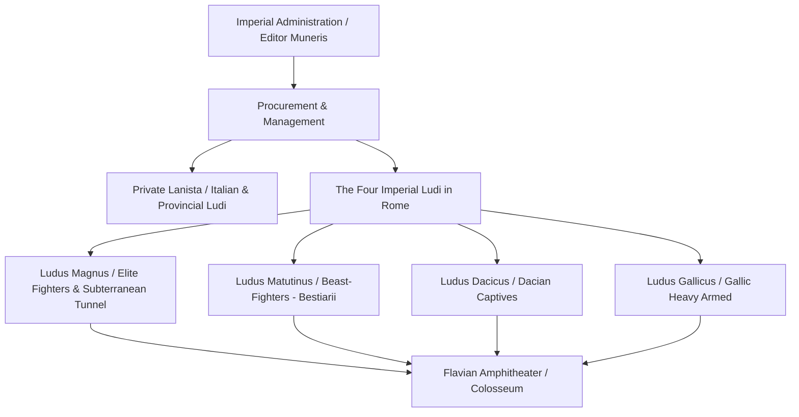

# Familiae Gladiatoriae

A *familia gladiatoria* was the collective corporate household, training troupe, and barracks community of gladiators owned by a private entrepreneur (*lanista*) or maintained by the imperial state under an equestrian procurator (*procurator ludi*)[^ancient-rome-ludus]. Originating in Campanian and Etruscan funerary games during the third century BCE, gladiatorial contests (*munera*) evolved into monumental instruments of elite aristocratic patronage and imperial mass entertainment. Troupes were trained, quartered, and disciplined inside specialized fortress-barracks (*ludi*), serving both as spectacle combatants in amphitheaters and, during the late Republic, as armed paramilitary retinues in urban civil warfare.

## Private Syndicates and the Lanista

In the Roman Republic and throughout the provinces of the High Empire, gladiatorial troupes were private commercial investments operated by a **lanista**:

* **Social Stigma (*Infamia*):** In Roman civil law, the lanista occupied a despised legal category, tainted by perpetual *infamia* alongside pimps (*lenones*) and actors. The lanista bought condemned criminals (*damnati ad ludum*), prisoners of war, refractory slaves sold by their masters, and impoverished freeborn volunteers (*auctorati*) who signed desperate contracts surrendering their bodily liberty.
* **The Auctoramentum Oath:** Freeborn recruits bound themselves to the lanista through a sacred, terrifying oath (*auctoramentum*): swearing "to be burned, bound, beaten, and slain with the sword" (*uri, vinciri, verberari, ferroque necari*) as a dutiful gladiator (Petronius, *Satyricon* 117)[^petronius-oath].
* **Leasing Contracts:** The lanista derived profits by leasing fighters to magistrates (*editores*) staging civic games. Contracts differentiated between gladiators who survived uninjured (billed at a modest leasing fee) and those who were slain or permanently crippled, for whom the editor had to purchase the gladiator's entire replacement value at catastrophic cost.

## Republican Weaponization and Slave Rebellions

During the first century BCE, the private ownership of large gladiatorial barracks created severe military and domestic security crises for the Roman Republic:

1. **The Third Servile War (73–71 BCE):** In 73 BCE, approximately seventy gladiators led by the Thracian auxiliary deserter **Spartacus** broke out of the gladiatorial school of Gnaeus Lentulus Batiatus in Capua. Arming themselves with kitchen spits and stolen gladiatorial weapons, they rapidly defeated Roman regional militias, mobilised tens of thousands of rural slaves across Campania and Lucania, and routed multiple consular armies before being crushed by Marcus Licinius Crassus.
2. **Paramilitary Urban Retinues:** In the street wars of the 50s BCE, conservative aristocrats such as Titus Annius Milo and Publius Sestius purchased private *familiae gladiatoriae* to serve as armed bodyguards against the plebeian gangs of Publius Clodius Pulcher. Stationed in private mansions, gladiators fought pitched battles across the Forum, intimidated tribunes, and guarded voting bridges during assembly elections[^mommsen-gladiators].

## Imperial Monopoly and the Four Ludi of Rome

Recognizing that armed private gladiators posed an existential threat to autocratic rule, Julius Caesar restricted the number of gladiators private citizens could keep in Rome. Augustus and his successors monopolized the games within the capital, barring private citizens from staging lavish spectacles without imperial authorization and transferring gladiatorial administration to equestrian imperial procurators (*procuratores ludi*).

Following the opening of the **Colosseum** (Flavian Amphitheater) under Titus and Domitian (c. 80–90 CE), the imperial administration constructed a massive state-run gladiatorial infrastructure on the Caelian and Esquiline hills, comprising **four specialized imperial ludi**[^ancient-rome-ludi]:

* **The Ludus Magnus:** The primary and most prestigious gladiatorial barracks in the empire, located directly east of the Colosseum across the Piazza del Colosseo. Excavations reveal a miniature amphitheater (seating roughly 3,000 spectators) in its central courtyard where gladiators practiced with blunt wooden swords (*rudes*), surrounded by multi-story residential barracks, armories (*armamentaria*), and treatment rooms. A subterranean vaulted tunnel connected the basement of the Ludus Magnus directly to the subterranean substructures (*hypogeum*) of the Colosseum, allowing heavily armored gladiators to march into the arena hidden from urban crowds.
* **The Ludus Matutinus:** Situated on the southern slope of the Caelian Hill near the Temple of Claudius, this school specialized exclusively in training beast-fighters (*bestiarii* and *venatores*). Its name derived from the fact that beast-hunts (*venationes*) were traditionally staged in the morning (*matutinum*) before the midday executions and afternoon gladiatorial duels.
* **The Ludus Dacicus:** Built by Domitian or Trajan to house and train barbarian prisoners taken during the Dacian Wars, located in Regio III near the Subura and the Baths of Trajan.
* **The Ludus Gallicus:** A smaller specialized barracks dedicated to heavy-armored Gallic combat styles (*murmillones* and *provocatores*), located adjacent to the Ludus Dacicus in Regio II.

## Internal Hierarchy and Barracks Life

Within the barracks (*ludus*), life was strictly ordered by seniority and martial specialization:

* **Doctors and Diet:** Because gladiators represented immense financial investments, imperial schools provided state-of-the-art medical care. The famous Greek physician **Galen** served as chief medical officer to the gladiators at Pergamum in 157–161 CE, pioneering surgical techniques for treating deep arterial cuts and tendon wounds. Gladiators consumed an energy-dense, alkaline diet of barley porridge, beans, and bone-ash tonics (*gladiatorum sagina*) designed to build subcutaneous fat that cushioned shallow sword slashes without severing muscle tissue.
* **Combat Specialization:** Trainees were classified under specialized weapon instructors (*doctores* or *magistri*):
  * *Retiarii* (net-and-trident skirmishers).
  * *Secutores* and *Murmillones* (heavy helmeted sword-and-shield fighters).
  * *Thraeces* (Thracian curved short-sword fighters).
  * *Hoplomachi* (spear-and-round shield fighters).
  * *Equites* (mounted gladiators) and *Essedarii* (chariot fighters).
* **The Wooden Sword (*Rudis*):** Gladiators who survived multiple bouts could win the wooden sword (*rudis*) from the editor, granting them freedom from the arena (*manumissio*). Many freed veterans (*rudiarii*) chose to remain in the school as highly paid *doctores*, trainers, and referees (*summi curatores*).

## Sources

[^ancient-rome-ludus]: Penelope J. E. Davies et al., *Ancient Rome: An Urban History* (Cambridge: Cambridge University Press), `_raw/Ancient Romeepub.pdf`, pp. 475, 506–507, analyzing the topographical locations, Regionary Catalogues, and archaeological plans of Rome's imperial gladiatorial barracks.
[^petronius-oath]: Petronius, *Satyricon* 117.5; see also Seneca, *Epistulae Morales* 37.1 on the legal and moral degradation of the gladiatorial contract (*auctoramentum*).
[^mommsen-gladiators]: Theodor Mommsen, *The History of Rome*, Book V, `_raw/_extracted/Mommsen - The History of Rome (bks. 1-5).txt`, chunk 4813, examining Milo's private gladiatorial retinues and the armed polarization of Republican politics.
[^ancient-rome-ludi]: Davies et al., *Ancient Rome: An Urban History*, `_raw/Ancient Romeepub.pdf`, p. 475; see also Darwall-Smith and Steinby, cited in `_raw/9789004401631-13611.pdf`, p. 435 (printed p. 419), examining the foundation dates, names, and functions of the Ludus Magnus, Ludus Matutinus, Ludus Dacicus, and Ludus Gallicus under the Flavians.
