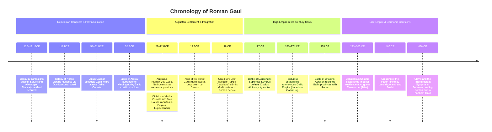

# Gaul (Gallia)

Gaul (*Gallia*) was the expansive Celtic-inhabited region of western Europe bounded by the Rhine (*Rhenus*), the Alps, the Mediterranean Sea, the Pyrenees, and the Atlantic Ocean. Rome's engagement with Gaul spanned centuries: from early defensive conflicts against Cisalpine Celts in northern Italy, through the establishment of *Gallia Transalpina* (later *Gallia Narbonensis*) in the late second century BCE, to Julius Caesar's conquest of *Gallia Comata* ("Long-haired Gaul") in 58–51 BCE. Under Augustus, the conquered interior was organized into the **Three Gauls** (*Tres Galliae*: Lugdunensis, Belgica, and Aquitania). Through rapid urbanization, agricultural wealth, and early senatorial enfranchisement under Claudius in 48 CE, Gaul became one of the most culturally Romanized and politically integrated core territories of the western Roman Empire.

## Chronology

## Geographic division: Cisalpina, Narbonensis, and Comata

Roman administrative and geographical usage distinguished three distinct zones across the Gallic cultural sphere:[^goodman-divisions]

1. **Gallia Cisalpina ("Gaul this side of the Alps"):** Northern Italy (the Po river valley and Venetia), conquered during the third and second centuries BCE and fully incorporated into the legal territory of *Italia* when Julius Caesar granted universal Roman citizenship to its communities in 49 BCE.
2. **Gallia Transalpina / Gallia Narbonensis:** The Mediterranean coastal corridor connecting Italy to Hispania, conquered in 125–121 BCE following appeals for assistance from Rome's Greek ally Massalia (Marseille). Centered on the veteran colony of *Narbo Martius* (Narbonne, founded 118 BCE), it was organized along classic Mediterranean civic lines with Roman and Latin colonies (Arelate, Nemausus, Arausio, Vienna). In 22 BCE, Augustus transferred Narbonensis to the Senate as a peaceful, demilitarized province—a territory so thoroughly Romanized that the elder Pliny later described it as *"Italia verius quam provincia"* ("more truly Italy than a province").[^ando-narbonensis]
3. **Gallia Comata ("Long-haired Gaul"):** The vast tribal interior beyond the Cévennes, encompassing central, western, and northern Gaul, populated by hundreds of autonomous Celtic and Belgic polities until Caesar’s campaigns.

## Caesarian conquest and the Augustan Three Gauls

Julius Caesar conquered Gallia Comata during the Gallic Wars (58–51 BCE), exploiting deep political rivalries among the Aedui, Arverni, Sequani, and Belgae. Despite a coordinated pan-Gallic revolt under the Arvernian nobleman Vercingetorix in 52 BCE, Caesar broke the coalition at the double-walled siege of Alesia. The conquest resulted in catastrophic casualties, enslavement, and the subjugation of indigenous warrior elites, while delivering immense wealth and a loyal veteran army that propelled Caesar to victory in the subsequent civil wars.[^pennell-caesar]

Between 27 and 12 BCE, Augustus and his son-in-law Marcus Vipsanius Agrippa reorganized Gallia Comata into three imperial provinces, collectively termed the **Tres Galliae**:[^goodman-divisions]

- **Gallia Lugdunensis:** The central zone extending from the Rhône to the Atlantic and English Channel, administered from the colonial capital of *Lugdunum* (Lyon, founded 43 BCE by L. Munatius Plancus).
- **Gallia Aquitania:** The southwestern territory extending from the Pyrenees to the Loire, incorporating both indigenous Aquitanian (proto-Basque) and Celtic peoples, governed from Mediolanum Santonum (Saintes) and later Burdigala (Bordeaux).
- **Gallia Belgica:** The northern and eastern frontier region extending along the Marne, Moselle, and Rhine, populated by Belgic and Germanic tribes, administered from Durocortorum (Reims) and later Augusta Treverorum (Trier).

At the confluence of the Rhône and Saône at Lugdunum, Drusus the Elder dedicated the monumental **Altar of the Three Gauls** (*Ara trium Galliarum*) in 12 BCE.[^claudius-birth] Here, representatives (*legati*) from the sixty-four recognized Gallic tribal communities convened annually as the Federal Council of the Gauls (*Concilium Galliarum*) to celebrate the imperial cult of Roma and Augustus, elect the chief priest of the province (*sacerdos ad aram*), and present joint petitions directly to the emperor.[^goodman-civitates]

## Urbanism, civic hierarchy, and the Lyon Tablet

Penelope Goodman's archaeological analysis highlights the stark structural contrast in provincial urban models across Gaul:[^goodman-urbanism]

- **Colonial Urbanism in Narbonensis:** Cities in southern Gaul were established primarily as *coloniae* featuring defined monumental centers (forums, basilicas, curiae, capitolia) ringed by extramural suburban infrastructures (amphitheaters, baths, necropolises, aqueducts).
- **Civitas-Capital Model in the Three Gauls:** In the Three Gauls, Rome transformed native tribal territories into self-governing administrative units (*civitates*), establishing new planned urban centers that preserved tribal identities in their administrative names—such as *Augustodunum* (Autun) for the Aedui, *Lutetia Parisiorum* (Paris) for the Parisii, and *Durocortorum Remorum* (Reims) for the Remi. Native aristocrats invested their private agrarian wealth into Roman public monuments, competing for civic prestige and local magistracies (*duoviri*).

A pivotal milestone in the political integration of provincial elites occurred in 48 CE under Emperor Claudius (himself born at Lugdunum in 10 BCE). When Gallic tribal nobles who already held Roman citizenship petitioned for the right to hold imperial magistracies in Rome and enter the Roman Senate (*ius honorum*), Italian senators resisted strongly, alleging that descendants of Caesar's enemies would overrun the curia. Claudius delivered a speech before the Senate defending the traditional Roman practice of incorporating defeated adversaries and provincial aristocrats into the citizen body. The text, preserved on the bronze **Lyon Tablet** (*Tabula Claudiana*, CIL XIII 1668) and summarized by Tacitus (*Annals* 11.23–25), secured senatorial admission for the Aeduan nobility and established a precedent for the enfranchisement of Western provincial elites across the empire.[^tabula-claudiana]

## Civil conflict and the Gallic Empire

Despite its stability, Gaul was central to major military upheavals:

- **The Clash of 197 CE:** Following the death of Commodus, the governor of Britain, Clodius Albinus, crossed into Gaul and established his headquarters at Lugdunum. On 19 February 197 CE, Septimius Severus defeated Albinus at the massive **Battle of Lugdunum**, involving an estimated 150,000 soldiers. Severus sacked and burned Lugdunum, executing scores of leading Gallic and Spanish aristocrats who had backed his rival and permanently crippling the city's commercial primacy.
- **The Gallic Empire (*Imperium Galliarum*, 260–274 CE):** During the catastrophic Third-Century Crisis, following the capture of Emperor Valerian by the Sasanians and continuous Frankish and Alamannic incursions across the Rhine, the military commander Postumus revolted in 260 CE. Supported by local elites and Rhine legions, he created an autonomous Roman breakaway state encompassing Gaul, Britain, and temporarily Hispania. Operating from capitals at Colonia Agrippina (Cologne) and Augusta Treverorum (Trier), the Gallic Empire maintained its own Senate, praetorian guard, and consuls, defending the Rhine frontier without attempting to march on Rome. It endured under Victorinus and Tetricus I until Emperor Aurelian defeated Tetricus at the Battle of Châlons in 274 CE, peacefully reintegrating Gaul into the central empire.[^kulikowski-crisis]

In Late Antiquity, under the Tetrarchy, Trier became the imperial residence of the Western Caesars. However, on the winter night of 31 December 406 CE, a confederation of Vandals, Alans, and Suebi crossed the frozen Rhine, overwhelming the frontier defenses and inaugurating the Germanic settlements that culminated in the establishment of the Frankish Kingdom under Clovis in the late fifth century.

## Sources

[^goodman-divisions]: Penelope J. Goodman, *The Roman City and its Periphery: From Rome to Gaul* (London: Routledge, 2007), [[_raw/The Roman City and its Periphery - From Rome to Gaul - Penelope Goodman.pdf#page=97|PDF pp.97–99, printed pp.80–82]], analyzing the social, political, and institutional distinction between Gallia Transalpina/Narbonensis and Gallia Comata / the Three Gauls.

[^ando-narbonensis]: Clifford Ando, *Imperial Ideology and Provincial Loyalty in the Roman Empire* (Berkeley: University of California Press, 2000), `_raw/_archived/Clifford Ando_2000_Imperial Ideology and Provincial Loyalty.epub`, chunk.830, detailing Augustus’s administrative settlement of Narbonensis in 22 BCE and its integration into the senatorial sphere.

[^pennell-caesar]: R. F. Pennell, *Ancient Rome: From the Earliest Times Down to 476 A.D.*, `_raw/_extracted/Pennell - Ancient Rome (From the Earliest Times Down to 476 A.D.).txt`, chunk.202, outlining the ethnic geography of Gaul and Caesar's conquest.

[^claudius-birth]: `_raw/_archived/9789004211964-16879.pdf`, [[_raw/_archived/9789004211964-16879.pdf#page=138|PDF p.138, printed p.126]], on the birth of Claudius at Lugdunum during Drusus the Elder's Germanic campaigns and the city's role as the center of the imperial cult of the Three Gauls.

[^goodman-civitates]: Goodman, *The Roman City and its Periphery*, [[_raw/The Roman City and its Periphery - From Rome to Gaul - Penelope Goodman.pdf#page=99|PDF p.99, printed p.82]], on the contrast between colonial foundations in the south and indigenous *civitas* administrative structures in the Three Gauls.

[^goodman-urbanism]: Goodman, pp. 82–105, 158, detailing the monumental center and suburban peripheral layout of Gallic administrative cities.

[^tabula-claudiana]: `_raw/_archived/9789004256675-24380.pdf`, [[_raw/_archived/9789004256675-24380.pdf#page=81|PDF p.81, printed p.63]], analyzing the Lyon Tablet (*Tabula Claudiana*, CIL XIII 1668), Tacitus (*Annals* 11.23–25), and Claudius's admission of Gallic *primores* into the Roman Senate.

[^kulikowski-crisis]: Michael Kulikowski, *The Triumph of Empire: The Roman World from Hadrian to Constantine* (Cambridge, MA: Harvard University Press, 2016), `_raw/_archived/Michael Kulikowski_2016_The Triumph of Empire.epub`, chunks 480–495, examining the formation, defense, and reintegration of the Gallic Empire under Postumus, Tetricus, and Aurelian.
