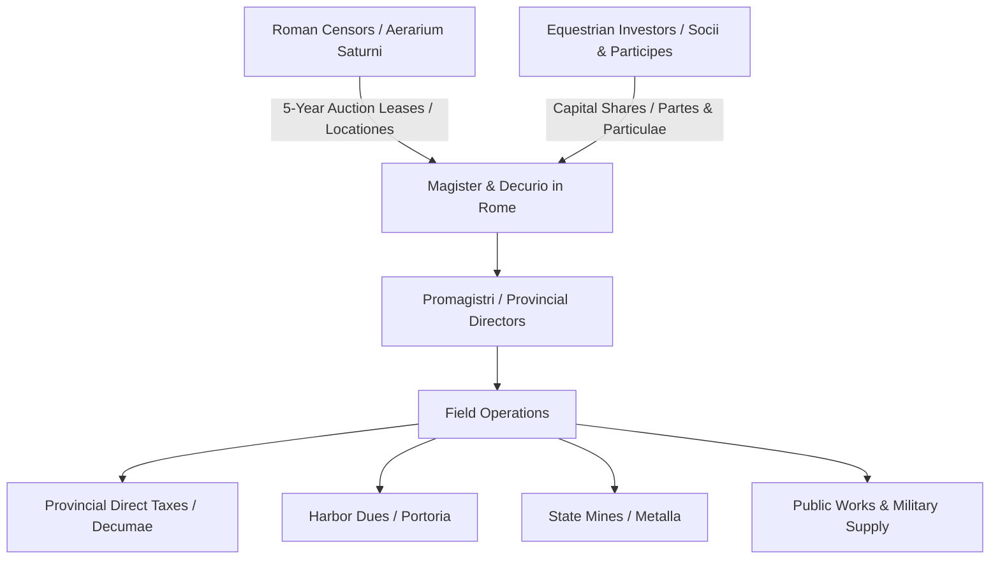

# Societates Publicanorum

The *societates publicanorum* were private financial syndicates and state-contracting corporations formed by Roman equites (*equestres*) to tender for public leases (*locationes*) auctioned by the censors. In Roman legal doctrine, ordinary private partnerships (*societates*) dissolved automatically upon the death, bankruptcy, or renunciation of a single partner (*socius*)[^pleket-shares]. By contrast, the legal framework governing *societates publicanorum* granted them exceptional corporate continuity and legal personhood due to their public necessity (*utilitas publica*)[^dig-continuity]. They functioned as joint-stock companies with tradeable financial shares (*partes*), a centralized directorate in Rome, and operational field offices spanning Mediterranean provinces.

## Legal Structure and Governance

The organizational structure of a *societas publicanorum* distinguished between senior active partners and passive financial investors:

* **The Manceps:** The formal principal who bid at the censorial auction in Rome, posted real estate collateral (*praedia*), and entered into legal covenant with the censors on behalf of the syndicate.
* **The Magister:** The executive managing director elected annually in Rome, responsible for operational correspondence, bookkeeping (*tabulae*), cash reserves, and communication with the Senate and magistrates.
* **Promagistri:** Stationed abroad in provincial hubs (such as Ephesus, Syracuse, or Corduba), promagistri directed regional operations, overseen by accountants (*tabularii*), armed guards, and local agents.
* **Socii and Participes:** *Socii* were the primary partners who contributed core equity and shared direct liabilities; *participes* were smaller investors holding fractional holdings (*partes* and *particulae*), which were bought, sold, and evaluated in the Forum near the Basilica Aemilia and the *Ianus Medius*[^cicero-shares].

Under Roman private law preserved in the Digest (Dig. 3.4.1; Dig. 17.2), the *societas publicanorum* was one of the few entities possessing a common corpus (*corpus habere*), a common treasury (*arca communis*), and an authorized legal agent (*actor* or *syndicus*) empowered to litigate in the corporation's name[^law-econ-perf].

## Operational Spheres

Censors let public contracts on a five-year cycle aligned with the *lustrum*:

1. **Provincial Tithes and Direct Taxes (*Vectigalia*):** Following the *Lex Sempronia de provincia Asia* passed by Gaius Gracchus in 123 BCE, the collection of the agricultural tithe (*decuma*) across the province of Asia was auctioned en bloc in Rome rather than negotiated locally. Syndicates paid the Roman treasury a fixed sum in advance and extracted the tithes from provincial communities, capturing the surplus as profit.
2. **Customs and Harbor Dues (*Portoria*):** Corporations farmed customs duties assessed at 2% to 5% (*quadragesima*) across customs districts (such as the *quadragesima Asiae* or *portorium Galliarum*), maintaining toll stations at frontier posts and maritime harbors like Puteoli and Ostia.
3. **State Mines and Quarries (*Metalla*):** Publicani leased gold, silver, copper, and cinnabar mines, notably the Rio Tinto silver-mining complex in Hispania and the gold mines of Vercellae in Cisalpine Gaul, employing large slave labor forces and engineering drain adits to extract mineral wealth[^polybius-mines].
4. **Logistics and Infrastructure:** Syndicates contracted for highway construction (such as the Via Appia and Via Flaminia), temple maintenance, aqueduct repairs, and provisioning legions abroad with grain, clothing, and remounts.

## Political Conflicts and Governor Friction

Because publicani sought to maximize recovery on their capital bids, provincial tax-farming frequently degenerated into extortion. Senatorial governors who attempted to enforce provincial edicts and curb publicani excesses faced political retaliation in Rome. Under the Gracchan judicial settlement, equestrian jurors staffed the extortion court (*quaestio de repetundis*). 

This institutional tension culminated in 92 BCE with the political prosecution of Publius Rutilius Rufus. As legate to Quintus Mucius Scaevola in Asia, Rufus had strictly suppressed illegal exactions by publicani collectors. Upon his return to Rome, the equestrian courts convicted Rufus on trumped-up charges of extortion, driving him into exile at Smyrna among the very provincials he had protected[^mommsen-rutilius].

Similarly, in 73 BCE, the *Oropus* land dispute required senatorial arbitration when publicani claimed the revenues of Amphiaraus' sacred lands in Boeotia under general Asian tax leases, despite Sulla's prior decree granting them tax immunity.

## Transition under the Principate

The predatory behavior of Republican syndicates led Augustus and his successors to curtail their authority:

* Direct property taxes (*tributum soli*) and personal head taxes (*tributum capitis*) were removed from private corporations and transferred to imperial procurators and municipal senates (*curiae*).
* The *societates publicanorum* were restricted to collecting indirect levies: the 5% inheritance tax (*vicesima hereditatium*), the 5% slave-manumission tax (*vicesima libertatis*), the 4% sales tax on slaves, and regional *portoria*.
* By the Antonine and Severan eras (second to third centuries CE), imperial administrations phased out private farming of indirect taxes entirely, transferring toll collection to directly appointed equestrian procurators and military detachments.

## Sources

[^pleket-shares]: Egbert Koops and Willem J. Zwalve, eds., *Law and Economic Performance in the Roman World* (Leiden: Brill, 2022), `_raw/9789004525139-63417.pdf`, p. 31 (printed p. 19), analyzing the legal persistence of *societates publicanorum* versus private partnerships and the nature of capital mobilization.
[^dig-continuity]: Digest 17.2.59 (Pomponius) and Gaius, *Institutiones* 3.148, establishing that the death of a member did not dissolve a tax-farming syndicate if corporate contracts remained in force.
[^cicero-shares]: Cicero, *In Verrem* 2.1.143 and *Pro Rabirio Postumo* 4, recording the negotiation and trade of *partes* in Forum business circles.
[^law-econ-perf]: Koops and Zwalve, *Law and Economic Performance in the Roman World*, `_raw/9789004525139-63417.pdf`, pp. 138–141 (printed pp. 126–129), examining corporate capacity, chirographs, and financial instruments.
[^polybius-mines]: Polybius 34.9.8 (cited in Strabo 3.2.10) on the New Carthage silver mines employing 40,000 workers under publicani oversight.
[^mommsen-rutilius]: Theodor Mommsen, *The History of Rome*, Book IV, `_raw/_extracted/Mommsen - The History of Rome (bks. 1-5).txt`, chunk 4813, examining equestrian judicial control and the trial of P. Rutilius Rufus.
