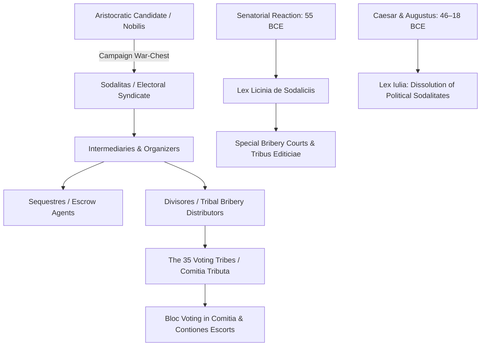

# Sodalitates

In Roman public life, the term *sodalitas* (or *sodalitium*) originally designated an intimate brotherhood, dining club, or religious fraternity bound by mutual vows (*sodales*) and common sacred feasts. During the second and first centuries BCE, however, ambitious members of the senatorial and equestrian elite systematically repurposed these elite social networks into sophisticated electoral syndicates. Organized across Rome's 35 voting tribes (*tribus*), these political *sodalitates* coordinated campaign finances, mobilized voting blocs, and distributed direct monetary bribes (*ambitus*) through specialized bagmen (*divisores*)[^mouritsen-sodalitates].

## Institutional Evolution: From Sacred Banquets to Electoral Cartels

The original Roman *sodalitates* were sacred sodalities established to celebrate ancestral rites, such as the *Luperci*, the *Salii*, and the sodalities maintaining archaic domestic cults. In the *Commentariolum Petitionis* (attributed to Quintus Tullius Cicero, c. 64 BCE), sodalities still appear as respectable networks of aristocratic mutual assistance:

> *"You have bound to yourself four sodalities of men most influential for electoral canvassing... ensure that you hold them firm by continuous attentiveness."* (*Comm. pet.* 19)[^comm-pet]

However, as the prize of high office grew increasingly lucrative following Mediterranean conquests—offering military imperium, plunder, and lucrative provincial governorships—the electoral competition in the *Comitia Centuriata* and *Comitia Tributa* outgrew traditional patron-client deference. Senatorial candidates began creating covert, highly specialized *sodalitates* explicitly designed to capture tribal voting majorities.

## Mechanics of Electoral Corruption

The operation of a political *sodalitas* relied on a division of labor designed to evade existing bribery laws (*leges de ambitu*):

1. **Decuriatio and Tribal Organization:** Syndicates mapped the electorate of specific voting tribes, subdividing citizens into centuries or decuriae. Influence peddlers registered voters, tracked their residence in the city or rural districts, and organized their transport to Rome on election days.
2. **The Divisores (Money Distributors):** Rather than handling illicit funds directly, candidates deposited immense sums with private banking syndicates. *Divisores* (official distributors originally appointed to handle lawful municipal grain or cash gifts) acted as covert bagmen, paying set cash bounties to enrolled tribesmen in return for their physical ballots (*tabellae*).
3. **The Sequestres (Escrow Agents):** To solve the problem of trust in illegal transactions, candidates and voter syndicates deposited bribery payments with neutral escrow trustees known as *sequestres*. Bribes were released to tribal leaders only after the candidate's formal victory was certified by the presiding magistrate.
4. **Physical Intimidation and Claque Operations:** *Sodales* provided loud, intimidating retinues (*sectatores*) that accompanied the candidate through the Forum Romanum, cheered his speeches at public assemblies (*contiones*), and physically blocked rival voters from entering the wooden polling gangways (*pontes*).

## The Legal Counter-Offensive: The Lex Licinia de Sodaliciis (55 BCE)

By the mid-50s BCE, electoral bribery reached crisis levels. In 55 BCE, the consul Marcus Licinius Crassus sponsored the **Lex Licinia de sodaliciis** to address organized tribal corruption:

* **Creation of the Crimen Sodalicium:** The law established a distinct, aggravated criminal offense (*crimen sodalicium*), defining membership in an organized electoral syndicate as a public felony separate from ordinary individual bribery (*ambitus*)[^schol-bob].
* **The Jury Selection Mechanism (*Editio Tribuum*):** To counteract the corrupt influence of local voting syndicates over jury panels, the *Lex Licinia* introduced a radical judicial procedure: the prosecutor (*accusator*) was granted the extraordinary privilege of naming four voting tribes from which the jury was drawn, leaving the defendant the right to reject only one tribe (*tribus rejectio*). The remaining three tribes supplied the jurors (*iudices editicii*). Because prosecutors selected tribes where the defendant's corrupt syndicates had alienated the local population, conviction rates surged.
* **The Trial of Gnaeus Plancius (54 BCE):** The most famous legal test of the statute occurred in 54 BCE, when Marcus Tullius Cicero defended his close political friend Gnaeus Plancius, who was prosecuted under the *Lex Licinia* by Marcus Iuventius Laterensis for allegedly employing *sodalitates* and *divisores* to purchase the curule aedileship. Cicero's published defense (*Pro Plancio*) remains the premier source for the internal workings, social psychology, and legal vulnerabilities of late Republican voting clubs[^pro-plancio].

## Suppression under Julius Caesar and Augustus

The chaotic civil wars of 49–31 BCE exposed political *sodalitates* as direct threats to state stability. Upon assuming autocratic power:

* **Dictatorship of Julius Caesar (46 BCE):** Caesar dissolved all political *sodalitates* and craft associations by decree, excepting only archaic religious sodalities and recognized Jewish prayer gatherings (Suetonius, *Divus Iulius* 42)[^caesar-ban].
* **The Lex Iulia de Collegiis (c. 18 BCE):** Augustus made the ban permanent. Any surviving association was required to obtain explicit authorization from the Senate and Princeps (*collegium legitimum*). Free associations of lower-class citizens were strictly curtailed: they were permitted to organize solely as mutual-aid burial clubs (*collegia tenuiorum*), legally barred from convening more than once a month or engaging in public political agitation (Dig. 47.22).
* **Transfer of Elections (14 CE):** Following Augustus' death, Tiberius transferred the election of magistrates from the popular assemblies to the Senate, permanently eliminating the electoral market that had sustained the *sodalitates*.

## Sources

[^mouritsen-sodalitates]: Henrik Mouritsen, *Plebs and Politics in the Late Roman Republic* (Cambridge: Cambridge University Press, 2001), `_raw/Plebs and Politics in the Late Roman Republicpdf.pdf`, pp. 157–160 (printed pp. 149–152), providing an extensive critical analysis of the *Lex Licinia de sodaliciis*, *divisores*, and the elite mechanics of electoral mobilization.
[^comm-pet]: Quintus Tullius Cicero (attrib.), *Commentariolum Petitionis* 19, advising Marcus Cicero on the strategic utility of binding elite *sodalitates* during his consular campaign of 64 BCE.
[^schol-bob]: Scholia Bobiensia 152 (Stangl ed.), commenting on the provisions and jury selection mechanisms (*tribus editiciae*) established under the *Lex Licinia de sodaliciis*.
[^pro-plancio]: Marcus Tullius Cicero, *Pro Plancio* 36–48, presenting the forensic arguments regarding electoral friendship versus illegal conspiratorial syndicates (*sodalitas*).
[^caesar-ban]: Suetonius, *Divus Iulius* 42.3 and *Divus Augustus* 32.1, recording the dissolution of political corporations and the enactment of the *Lex Iulia*.
