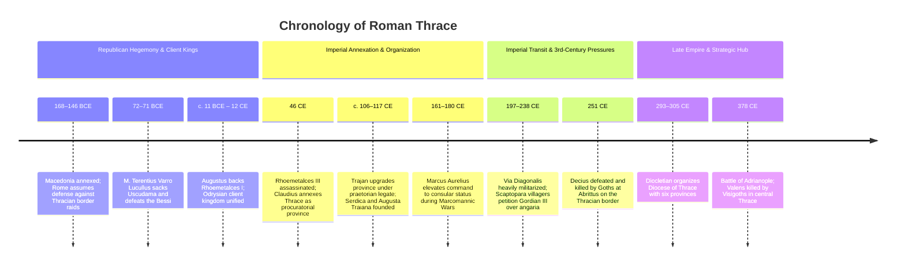

# Thracia

Thracia (Thrace) was a major historical region and imperial Roman province occupying the southeastern Balkan Peninsula, bounded by the Danube (*Danuvius*) and the Haemus Mountains (Balkan range) to the north, the Aegean Sea and Propontis (Sea of Marmara) to the south, Macedonia to the west, and the Black Sea (*Pontus Euxinus*) to the east. Long governed through client treaties with native Odrysian and Sapaean dynasts, Thrace was formally annexed by Emperor Claudius in 46 CE following internal dynastic violence. It functioned as an indispensable military transit corridor between the western and eastern halves of the empire, a premier source of auxiliary cavalry and infantry manpower, and the territorial shield protecting Byzantium and later Constantinople.

## Chronology

## The Odrysian kingdom and Republican diplomacy

Following the creation of the province of Macedonia in 146 BCE and the acquisition of the Thracian Chersonese through the bequest of the Attalid kingdom in 133 BCE, Rome became responsible for securing the Aegean littoral and the Via Egnatia against upland Thracian tribes.[^mommsen-frontier] The powerful Bessi in the Rhodope mountains and the Odrysians in the Hebros river valley mounted recurring incursions into Roman Macedonia, provoking retaliatory consular expeditions.[^naco-thrace]

In 72–71 BCE, proconsul Marcus Terentius Varro Lucullus marched across the Haemus, defeated the Bessi, and captured their capital at Uscudama (later Adrianople / Edirne), while extracting alliances from the Odrysian king Sadalas and the Greek coastal poleis (Histria, Tomis, Callatis, Apollonia).[^mommsen-lucullus] 

Under Augustus, Rome replaced direct military policing with a unified client monarchy under the Sapaean-Odrysian dynasty. King Rhoemetalces I (ruled c. 11 BCE – 12 CE) suppressed native anti-Roman insurgencies, assisted Roman forces during the Great Illyrian Revolt (6–9 CE), and minted joint bronze coinage pairing his own portrait with that of Augustus and Livia, visually broadcasting imperial alignment and client-king legitimacy.[^domina-coins] Tacitus noted that under Tiberius, the security of the Balkan interior rested directly on Rhoemetalces' sons and client dynasts while Roman legions guarded the Danube bank in Moesia.[^tacitus-armies]

## Claudian annexation and administrative evolution

Dynastic factionalism and anti-Roman uprisings destabilized the client kingdom in the early first century CE. In 46 CE, following the assassination of the client king Rhoemetalces III in a domestic conspiracy, Emperor Claudius abolished the monarchy and annexed Thrace as an imperial province (*Provincia Thracia*).[^scarre-annexation][^roman-imperialism]

Initially, Thrace was organized as a procuratorial province governed by an equestrian *procurator Augusti* seated at Perinthus (Heraclea) on the Propontis, reflecting its pacified interior status without a permanent legionary garrison. However, Trajan reorganized the territory in the early second century CE, elevating it to a praetorian imperial command administered by a senatorial *legatus Augusti pro praetore*.[^parissaki-status] During the Marcomannic Wars under Marcus Aurelius, the strategic exposure of the Balkan corridor prompted the elevation of the governorship to consular rank.

## Urbanization, military recruitment, and civic petitions

Unlike the tribal interior of pre-Roman Dacia or the Three Gauls, southern and coastal Thrace possessed ancient Greek urban centers (Abdera, Maroneia, Aenus, Byzantium, Mesembria). Under Trajan and Hadrian, the interior was systematically urbanized along Roman municipal lines:

- **Imperial Foundations:** Major cities were established or reorganized as self-governing poleis with Greek administrative institutions, including Philippopolis (Plovdiv), Serdica (Sofia), Augusta Traiana (Stara Zagora), Trajanopolis, and Hadrianopolis (Edirne).
- **Transit Infrastructure:** The province was traversed by the *Via Diagonalis* (or *Via Militaris*), the vital imperial arterial highway running from Singidunum (Belgrade) via Serdica and Philippopolis directly to Byzantium, alongside the coastal *Via Egnatia*.[^traffic-transit]
- **Military Manpower:** Thrace was renowned as one of the empire's most fertile recruiting grounds for auxiliary soldiers. Thracian cohorts and cavalry regiments (*alae Thracum*) served across the Rhine and Danube limes, Britannia, and Syria, while Thracian gladiators (*thraeces*) were famous in amphitheaters across the empire.[^zahariade-auxilia]

The heavy military traffic along the Via Diagonalis created severe fiscal burdens for provincial villages. In 238 CE, the inhabitants of the Thracian village of Scaptopara dispatched an embassy to Emperor Gordian III, preserving an epigraphic petition (CIL III 12336) protesting against soldiers, imperial messengers, and magistrates who routinely abandoned the military highway to extort free lodging, baths, and draft animals under the compulsory transport requisition system (*angaria*), threatening the total depopulation of the community.[^scaptopara-petition]

## Late Antiquity and the road to Adrianople

Under Diocletian's administrative reforms in 293 CE, Thrace became the core of the **Diocese of Thrace** (*Dioecesis Thraciae*), governed by a *vicarius* under the praetorian prefecture of the East. The diocese was partitioned into six provinces: Europa, Thracia, Haemimontus, Rhodope, Moesia Secunda, and Scythia.

Following the foundation of Constantinople as the new imperial capital by Constantine in 330 CE, Thrace became the immediate European hinterland and agricultural breadbasket of the imperial court. This strategic position also made it the primary battleground against northern Germanic and nomadic incursions. In 378 CE, Emperor Valens engaged the rebellious Visigoths outside Adrianople; the Roman field army was annihilated and Valens killed at the catastrophic Battle of Adrianople, inaugurating a prolonged period of military vulnerability throughout the Balkan provinces.

## Sources

[^mommsen-frontier]: Theodor Mommsen, *The History of Rome*, Book IV, `_raw/Mommsen - The History of Rome (bks. 1-5).pdf`, p. 1210, detailing Rome's assumption of border defense against Thrace following the creation of the province of Macedonia.

[^naco-thrace]: Toni Ñaco del Hoyo and Isaías Arrayás-Morales, “Rome, Pontus, Thrace and the Military Disintegration of the World Beyond the Hellenistic East,” in *Rome and the Worlds Beyond Its Frontiers*, ed. D. Slootjes and M. Peachin (Leiden: Brill, 2016), [[_raw/_archived/9789004326750-33699.pdf#page=14|PDF pp.14–24, printed pp.3–12]], analyzing Republican frontier conflict, mercenary networks, and the collapse of Hellenistic buffer dynamics.

[^mommsen-lucullus]: Mommsen, *History of Rome*, Book V, `_raw/_extracted/Mommsen - The History of Rome (bks. 1-5).txt`, chunk.4109, on Marcus Lucullus' 72–71 BCE campaigns against the Bessi and the submission of Uscudama.

[^domina-coins]: `_raw/_archived/Dominaepub.pdf`, pp. 176–182, analyzing the joint bronze coinage of King Rhoemetalces I, Queen Pythodoris, Augustus, and Livia (source ID: B04:Dominaepub.pdf).

[^tacitus-armies]: *Traffic and Congestion in the Roman Empire*, `_raw/_archived/Traffic and Congestion in the Roman Empireepub.decrypted.epub`, chunk.205 (citing Tacitus, *Annals* 4.5), describing the division of imperial garrison commands and client rule under Rhoemetalces and the sons of Cotys.

[^scarre-annexation]: Chris Scarre, *The Penguin Historical Atlas of Ancient Rome*, `_raw/_extracted/The Penguin Historical Atlas of Ancient Rome - Chris Scarre.txt`, chunk.101, documenting Claudius’s annexation of Thrace in 46 CE.

[^roman-imperialism]: *Roman Imperialism: Readings and Sources*, `_raw/_archived/Roman Imperialismpdf.pdf`, [[_raw/_archived/Roman Imperialismpdf.pdf#page=26|PDF p.26, printed p.19]], on the transition from client kingdoms to standing provinces under the Principate.

[^parissaki-status]: M.-G. Parissaki, “Thrace under Roman Sway (146 BC–AD 46),” cited in Ñaco del Hoyo and Arrayás-Morales, [[_raw/_archived/9789004326750-33699.pdf#page=24|PDF p.24, printed p.12]].

[^traffic-transit]: *Traffic and Congestion in the Roman Empire*, chunks 204–207, tracing the Balkan highways and communication routes between the Danube legions and the Bosporus.

[^zahariade-auxilia]: M. Zahariade, *The Thracians in the Roman Imperial Army: Auxilia*, cited in [[_raw/_archived/9789004326750-33699.pdf#page=23|PDF p.23, printed p.11]].

[^scaptopara-petition]: Corpus Inscriptionum Latinarum (CIL) III 12336 (Sylloge Inscriptionum Graecarum 888), the petition of the villagers of Scaptopara to Gordian III concerning official transport abuse and *angaria*.
